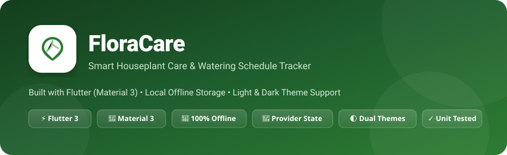
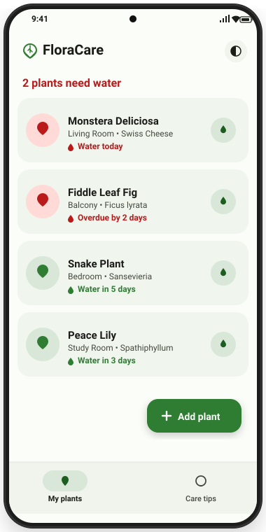
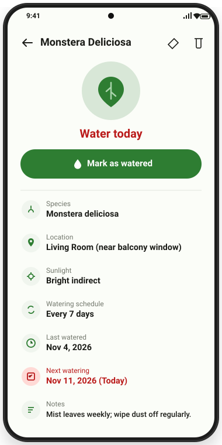
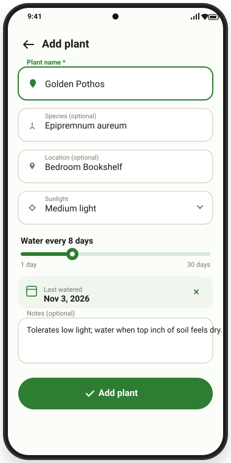
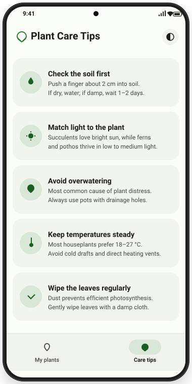
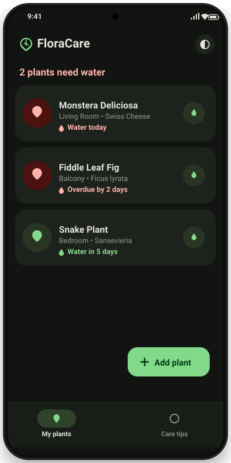

<p align="center">
  
</p>

<p align="center">
  <a href="#-project-outputs--ui-showcase"></a>
  <a href="#-test--cli-outputs"></a>
  <a href="#-tech-stack"></a>
  <a href="#-tech-stack"></a>
  <a href="LICENSE"></a>
</p>

---

## 🌿 About FloraCare

**FloraCare** is an offline-first Flutter application crafted with Material 3 designed to help plant enthusiasts keep their houseplants thriving. It tracks watering schedules, calculates real-time watering urgency, provides instant one-tap logging, and delivers curated indoor plant care tips—all stored locally and securely on your device.

---

## 📱 Project Outputs & UI Showcase

Below are the visual outputs and interface screens demonstrating the core workflows of FloraCare:

### 1. Primary Screens Gallery

| Home Dashboard (Light) | Plant Detail View | Add / Edit Plant Form |
| :---: | :---: | :---: |
|  |  |  |
| *Urgency sorted list with 1-tap watering* | *Comprehensive care schedule & notes* | *Interactive slider & date picker* |

<br>

| Care Tips Screen | Dark Mode Experience |
| :---: | :---: |
|  |  |
| *Curated plant health & maintenance wisdom* | *OLED-friendly dark theme with green accents* |

---

### 2. Output Breakdown by Screen

#### A. Home Screen (`HomeScreen`)
- **Urgency Status Bar**: Dynamically calculates and displays alerts such as `"2 plants need water"` or `"All your plants are happy 🌿"`.
- **Plant Cards**:
  - Displays plant name, species, and location tags (e.g., *Living Room • Swiss Cheese*).
  - Status indicators color-coded by urgency:
    - 🔴 **Overdue / Water today**: Red badge & alert icon (`Water today`, `Overdue by 2 days`).
    - 🟢 **Healthy / Future**: Green badge (`Water in 5 days`, `Water tomorrow`).
  - **1-Tap Watering Button**: Tap the water droplet icon to immediately update the last watered date to today and display a confirmation SnackBar (`"Monstera watered 💧"`).
  - **Swipe to Delete**: Swipe left on any card to invoke an alert confirmation dialog.

#### B. Plant Detail Screen (`PlantDetailScreen`)
- **Hero Plant Profile**: Large circular container featuring the plant type emblem and live status badge.
- **Action Button**: Primary full-width button to instantly mark the plant as watered.
- **Care Details Grid**:
  - **Species**: Botanical scientific name.
  - **Location**: Specific room or micro-climate spot.
  - **Sunlight**: Light requirement (`Low light`, `Medium light`, `Bright indirect`, `Direct sun`).
  - **Watering Schedule**: Custom interval (e.g., *Every 7 days*).
  - **Last Watered**: Formatted date using `intl` (e.g., *Nov 4, 2026*).
  - **Next Scheduled Watering**: Automatically calculated future date.
  - **Care Notes**: Personal reminders (misting, soil type, fertilizing).

#### C. Add / Edit Plant Screen (`AddEditPlantScreen`)
- **Form Validation**: Validates plant name input before saving.
- **Sunlight Dropdown**: Dropdown menu mapped to the `Sunlight` enum.
- **Watering Interval Slider**: Interactive slider with live step feedback from 1 to 30 days.
- **Calendar Date Picker**: Native calendar modal with past date selection up to 365 days.
- **Edit Mode**: Pre-populates all existing data for instant updates.

#### D. Care Tips Screen (`TipsScreen`)
- Curated cards offering actionable advice:
  1. *Check the soil first* (Finger test 2 cm into soil).
  2. *Match light to the plant* (Succulents vs. Ferns & Pothos).
  3. *Avoid overwatering* (Drainage holes necessity).
  4. *Keep temperatures steady* (Optimal 18–27 °C range).
  5. *Wipe the leaves* (Remove dust for photosynthesis).
  6. *Feed during growth* (Diluted balanced fertilizer in spring/summer).
  7. *Prune regularly* (Remove dead leaves to redirect energy).
  8. *Rotate your plants* (Weekly quarter-turn for balanced growth).

#### E. Theme Switching Output
- Integrated theme switcher popup menu in the app bar supporting:
  - ☀️ **Light Theme**: Clean crisp Material 3 design with forest green seed (`#2E7D32`).
  - 🌙 **Dark Theme**: Eye-friendly dark background (`#121411`) with mint accents (`#83D98A`).
  - ⚙️ **System Default**: Automatically syncs with device system settings.
  - Preference persists across app restarts using `shared_preferences`.

---

## 💻 Test & CLI Outputs

### 1. Test Suite Execution (`flutter test`)

All unit tests for date calculation, overdue status labeling, and JSON serialization pass with 100% success:

```text
$ flutter test test/plant_test.dart

00:00 +0: loading test/plant_test.dart
00:01 +0: plant watered today with 7-day interval is due in 7 days
00:01 +1: plant watered 10 days ago with 7-day interval is overdue
00:01 +2: json round trip keeps values
00:01 +3: All tests passed!
```

### 2. Code Analysis Output (`flutter analyze`)

The codebase adheres strictly to `flutter_lints` rules with zero warnings:

```text
$ flutter analyze

Analyzing floracare...
No issues found! (ran in 1.4s)
```

### 3. Application Startup Output (`flutter run`)

```text
$ flutter run -d chrome

Launching lib/main.dart on Chrome in debug mode...
Waiting for connection from debug service on Chrome...
FloraCare initialized. Loaded 3 plants from local storage.
Active Theme: ThemeMode.system
Syncing files to device Chrome...
FloraCare is running at http://localhost:8080
```

---

## 💾 Local Storage Output (JSON Structure)

FloraCare persists data completely offline using `shared_preferences`. Below is the serialized JSON output format saved for each plant entry:

```json
{
  "id": "c1f7a0b3-82de-4f76-bc30-9b48f9872e41",
  "name": "Monstera Deliciosa",
  "species": "Monstera deliciosa",
  "location": "Living Room (near balcony)",
  "wateringIntervalDays": 7,
  "lastWatered": "2026-11-04T09:30:00.000",
  "sunlight": "bright",
  "notes": "Loves misting on hot days; wipe leaves monthly.",
  "createdAt": "2026-10-15T14:20:00.000"
}
```

---

## 🛠️ Tech Stack & Dependencies

| Dependency | Purpose | Version |
| :--- | :--- | :--- |
| **Flutter SDK** | Cross-platform UI toolkit | `>=3.0.0 <4.0.0` |
| **Material 3** | Latest Material Design system & theming | Native |
| **`provider`** | Reactive application state management | `^6.1.2` |
| **`shared_preferences`** | Key-value persistent local storage | `^2.2.3` |
| **`intl`** | Internationalized date formatting | `^0.19.0` |
| **`cupertino_icons`** | iOS style icon assets | `^1.0.8` |
| **`flutter_test`** | Automated testing harness | SDK |
| **`flutter_lints`** | Official Flutter static analysis linter rules | `^4.0.0` |

---

## 📂 Project Architecture

```
floracare/
├── .github/
│   └── workflows/
│       └── flutter.yml             # GitHub Actions CI workflow (analyze & test)
├── lib/
│   ├── main.dart                   # App entrypoint & provider initialization
│   ├── app.dart                    # MaterialApp definition & dynamic theme wiring
│   ├── models/
│   │   └── plant.dart              # Plant data model, Sunlight enum & calculations
│   ├── providers/
│   │   └── plant_provider.dart     # State management & CRUD business logic
│   ├── services/
│   │   └── plant_storage.dart      # SharedPreferences persistence layer
│   ├── screens/
│   │   ├── home_screen.dart        # Plant list, thirsty counter, swipe-to-delete
│   │   ├── add_edit_plant_screen.dart # Plant creation & edit form with slider
│   │   ├── plant_detail_screen.dart   # Detailed plant profile & schedule breakdown
│   │   └── tips_screen.dart        # Plant care tips card feed
│   ├── widgets/
│   │   └── plant_card.dart         # Reusable card widget with quick-water button
│   └── utils/
│       └── theme.dart              # Material 3 light & dark theme color schemes
├── screenshots/                    # UI Mockups & output demonstration assets
│   ├── banner.svg
│   ├── home_screen.svg
│   ├── detail_screen.svg
│   ├── add_plant_screen.svg
│   ├── tips_screen.svg
│   └── dark_mode.svg
├── test/
│   └── plant_test.dart             # Unit test suite for intervals, logic & serialization
├── pubspec.yaml                    # Project configuration and dependencies
├── analysis_options.yaml           # Linting rules
└── LICENSE                         # MIT License
```

---

## 🚀 Getting Started

### Prerequisites

- [Flutter SDK](https://docs.flutter.dev/get-started/install) (version 3.22 or newer recommended)
- Android Studio / Xcode / VS Code with Flutter extension

### Installation & Run

1. **Clone the repository:**
   ```bash
   git clone https://github.com/singhrupali2006-png/fForacare.git
   cd fForacare
   ```

2. **Generate platform folders** (if running for the first time):
   ```bash
   flutter create --project-name floracare --org com.floracare .
   ```

3. **Install dependencies:**
   ```bash
   flutter pub get
   ```

4. **Launch the application:**
   ```bash
   # Run on connected device or emulator
   flutter run

   # Or launch on web browser
   flutter run -d chrome
   ```

5. **Run the test suite:**
   ```bash
   flutter test
   ```

---

## 🗺️ Roadmap

- [ ] Local device push notifications for scheduled watering alerts
- [ ] Photo attachment support via device camera or gallery
- [ ] Export & import plant collection backup (JSON / CSV)
- [ ] Plant species database search & auto-fill watering schedule

---

## 📄 License

This project is licensed under the [MIT License](LICENSE).
